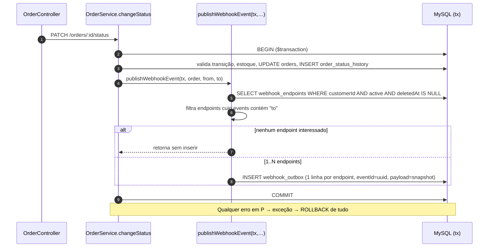
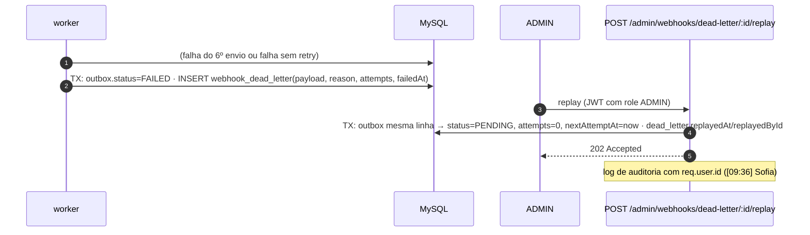

# FDD — Sistema de Webhooks de Notificação de Pedidos

| Campo | Valor |
|---|---|
| **Status** | Pronto para implementação |
| **Data** | 2026-10-15 |
| **Base** | Reunião técnica de quinta-feira, 09:00 ([`TRANSCRICAO.md`](../TRANSCRICAO.md)) e código atual do OMS |
| **Documentos relacionados** | [PRD](PRD.md) · [RFC](RFC.md) · [ADRs](adrs/README.md) · [Tracker](TRACKER.md) |

> **Convenção deste documento.** As justificativas das decisões estão nos ADRs e não se repetem aqui.
> Itens marcados com ***(proposta)*** são detalhes de implementação que a reunião não fixou. Eles foram
> escolhidos neste FDD para torná-lo acionável e podem ser ajustados na revisão de código.
> Todo o resto tem origem na transcrição (`[hh:mm] Nome`) ou no código (`caminho:linha`).

---

## 1. Contexto e motivação técnica

Clientes B2B fazem polling em `GET /orders` para descobrir mudanças de status ([09:00] Marcos). O OMS não tem eventos, filas nem notificação externa. Toda mudança de status passa por `OrderService.changeStatus` (`src/modules/orders/order.service.ts:126`), dentro de um `prisma.$transaction` (linha 131) que já debita ou repõe estoque, atualiza `orders` e grava `order_status_history` (linhas 151–167).

O desafio técnico é **emitir um evento externo a partir dessa transação** sem acoplar a sua latência ou o seu sucesso ao endpoint do cliente ([09:04] Bruno), e sem jamais emitir um evento de uma mudança que não foi efetivada ([09:40] Bruno). Arquitetura e alternativas estão no [RFC](RFC.md).

## 2. Objetivos técnicos

| # | Objetivo | Medida | Origem |
|---|---|---|---|
| OT-1 | Notificar o cliente em menos de 10 s após o commit da mudança de status | Polling ≤ 2 s + envio com timeout de 10 s | [09:02] Marcos, [09:09] Diego |
| OT-2 | Evento gravado na mesma transação da mudança de status | Rollback desfaz os dois; falha na outbox desfaz a mudança | [09:06] Diego, [09:40] Bruno |
| OT-3 | Nenhum evento perdido por indisponibilidade do cliente | 1 envio + 5 retentativas (~15 h) e depois DLQ | [09:17] Larissa, [ADR-003](adrs/ADR-003-retry-backoff-e-dlq.md) |
| OT-4 | Autenticidade e integridade verificáveis pelo cliente | HMAC-SHA256 com secret por endpoint | [09:22] Sofia |
| OT-5 | Zero infraestrutura nova e zero dependência nova | Mesmo MySQL, Prisma, Pino, Zod e `uuid` já instalados | [09:07] Diego, [09:29] Bruno |

## 3. Escopo e exclusões

**Incluso:**
- inserção na outbox a partir de `changeStatus`;
- worker com polling, retry e DLQ;
- CRUD de webhooks;
- rotação de secret;
- histórico de entregas;
- replay de DLQ por ADMIN;
- assinatura HMAC e headers de entrega.

**Excluído nesta fase:**

| Item | Origem |
|---|---|
| Webhooks inbound | [09:02] Marcos |
| Email de alerta ao cliente | [09:37] Larissa |
| Dashboard visual | [09:40] Larissa |
| Rate limiting de saída (observar) | [09:39] Larissa |
| Múltiplos workers | [09:13] Diego |
| Arquivamento de linhas após ~30 dias | [09:08] Diego |
| Evento na **criação** do pedido (`create()`, `order.service.ts:95-113`) | decisão R3 do [RFC](RFC.md) |
| Endpoint para **listar** a DLQ (a reunião só definiu o replay por id; questão em aberto Q6 do [RFC](RFC.md#5-questões-em-aberto)) | [09:18] Diego |

## 4. Modelo de dados

Novas tabelas em `prisma/schema.prisma`, seguindo o padrão de UUID `@id @default(uuid()) @db.Char(36)` (`prisma/schema.prisma:26`, [09:51] Larissa) e de `@@map` em snake_case.

```prisma
enum WebhookOutboxStatus {
  PENDING      // aguardando 1º envio ou próximo retry
  PROCESSING   // em envio pelo worker
  DELIVERED    // cliente respondeu 2xx
  FAILED       // tentativas esgotadas → copiado para a DLQ (estado terminal na outbox)
}

model WebhookEndpoint {
  id                      String    @id @default(uuid()) @db.Char(36)
  customerId              String    @db.Char(36)
  url                     String    @db.VarChar(2048)
  events                  Json      // array de OrderStatus, ex.: ["SHIPPED","DELIVERED"]
  secret                  String    @db.VarChar(128)
  previousSecret          String?   @db.VarChar(128)
  previousSecretExpiresAt DateTime?
  active                  Boolean   @default(true)
  deletedAt               DateTime?
  createdAt               DateTime  @default(now())
  updatedAt               DateTime  @updatedAt

  customer   Customer             @relation(fields: [customerId], references: [id])
  outbox     WebhookOutbox[]
  deliveries WebhookDelivery[]
  deadLetters WebhookDeadLetter[]

  @@index([customerId, active])
  @@map("webhook_endpoints")
}

model WebhookOutbox {
  id                String              @id @default(uuid()) @db.Char(36)
  eventId           String              @unique @db.Char(36)   // enviado em X-Event-Id
  webhookEndpointId String              @db.Char(36)
  orderId           String              @db.Char(36)
  eventType         String              @db.VarChar(64)        // "order.status_changed"
  payload           Json                                       // snapshot renderizado na inserção
  status            WebhookOutboxStatus @default(PENDING)
  attempts          Int                 @default(0)
  nextAttemptAt     DateTime            @default(now())
  lastErrorCode     String?             @db.VarChar(64)
  deliveredAt       DateTime?
  createdAt         DateTime            @default(now())
  updatedAt         DateTime            @updatedAt

  webhookEndpoint WebhookEndpoint @relation(fields: [webhookEndpointId], references: [id])

  @@index([status, createdAt])
  @@index([status, nextAttemptAt])
  @@map("webhook_outbox")
}

model WebhookDelivery {
  id                String   @id @default(uuid()) @db.Char(36)
  outboxId          String   @db.Char(36)
  webhookEndpointId String   @db.Char(36)
  eventId           String   @db.Char(36)
  attempt           Int
  success           Boolean
  responseStatus    Int?
  responseBody      String?  @db.Text      // truncado em 4 KB (proposta)
  durationMs        Int
  errorCode         String?  @db.VarChar(64)
  createdAt         DateTime @default(now())

  webhookEndpoint WebhookEndpoint @relation(fields: [webhookEndpointId], references: [id])

  @@index([webhookEndpointId, createdAt])
  @@map("webhook_deliveries")
}

model WebhookDeadLetter {
  id                String    @id @default(uuid()) @db.Char(36)
  outboxId          String    @unique @db.Char(36)
  webhookEndpointId String    @db.Char(36)
  eventId           String    @db.Char(36)
  payload           Json
  reason            String    @db.VarChar(500)
  attempts          Int
  failedAt          DateTime  @default(now())
  replayedAt        DateTime?
  replayedById      String?   @db.Char(36)

  webhookEndpoint WebhookEndpoint @relation(fields: [webhookEndpointId], references: [id])

  @@index([failedAt])
  @@map("webhook_dead_letter")
}
```

Notas de modelagem:
- **Uma linha de outbox por par evento × webhook**, cada uma com o seu `eventId` (decisão R2 do [RFC](RFC.md), [ADR-005](adrs/ADR-005-entrega-at-least-once-com-x-event-id.md)).
- **Índices em `status` e `created_at`** ([09:08] Diego). O índice composto com `nextAttemptAt` serve aos retries agendados *(proposta)*.
- **Status `FAILED`** *(proposta, resolve AMB-02)*. A reunião listou "pendente, processando, falhou, entregue" ([09:08] Diego) **e** decidiu por uma DLQ separada ([09:18] Diego). Aqui, `FAILED` é o estado terminal da linha na outbox. A evidência completa fica em `webhook_dead_letter`, e o worker nunca lê linhas `FAILED`.
- **`events` como `Json`** *(proposta)*: o MySQL não suporta arrays de enum no Prisma. A validação do conteúdo é feita pelo Zod com `z.nativeEnum(OrderStatus)`.
- **`deletedAt`** *(proposta)*: o `DELETE` é lógico, para preservar o histórico de entregas e a DLQ, que são evidência para debug ([09:18] Diego).
- **`Customer`** ganha a relação inversa `webhookEndpoints WebhookEndpoint[]`.

## 5. Fluxos detalhados

### 5.1 Criação do evento na outbox (dentro de `changeStatus`)



1. `publishWebhookEvent` é chamada **depois** de `tx.orderStatusHistory.create(...)` (`order.service.ts:159-167`) e **antes** do `findUnique` de retorno (linha 169) ([09:41] Bruno).
2. O filtro acontece aqui, na inserção ([09:34] Bruno, [ADR-007](adrs/ADR-007-payload-snapshot-e-filtro-na-insercao.md)).
3. O snapshot é montado com os dados de `order` (linha 132) e com `to`. Ver o formato em §6.8.
4. O `eventId` é gerado com `uuid` v4, já presente em `package.json:32` ([09:25] Diego).
5. Qualquer exceção propaga e o `$transaction` faz rollback ([09:40] Bruno).

### 5.2 Processamento pelo worker

```mermaid
sequenceDiagram
    autonumber
    participant W as worker (src/worker.ts → webhook.processor.ts)
    participant DB as MySQL
    participant CL as Endpoint do cliente
    loop a cada 2 s
        W->>DB: SELECT … FROM webhook_outbox WHERE status=PENDING AND nextAttemptAt<=now() ORDER BY createdAt LIMIT 10
        W->>DB: UPDATE status=PROCESSING (ids do lote)
        loop para cada evento, em ordem de createdAt
            W->>DB: carrega webhook_endpoint (ativo? secret)
            W->>W: corpo = JSON(payload); checa 64 KB; X-Signature = HMAC-SHA256(secret, corpo)
            W->>CL: POST url (timeout 10 s)
            alt 2xx
                W->>DB: status=DELIVERED, deliveredAt, attempts+1 · INSERT webhook_deliveries(success)
            else timeout / rede / não-2xx
                W->>DB: INSERT webhook_deliveries(falha) · ver §5.3
            end
        end
    end
```

- **Intervalo de 2 s** entre ciclos ([09:09] Diego). O próximo ciclo só começa quando o atual termina, para não haver dois ciclos sobrepostos *(proposta)*.
- **Lote de 10 eventos** *(proposta: a reunião disse "batch pequeno", [09:08] Diego)*.
- **Os eventos do lote são enviados em sequência, não em paralelo.** Isso preserva a ordem de `createdAt` ([09:12] Diego).
- **Recuperação de crash** *(proposta)*: ao iniciar, o worker devolve para `PENDING` as linhas que ficaram em `PROCESSING`. Um evento pode então ser reenviado, o que é coerente com a garantia at-least-once ([ADR-005](adrs/ADR-005-entrega-at-least-once-com-x-event-id.md)).
- **Endpoint inativo ou removido no momento do envio** *(proposta)*: o evento vai direto para a DLQ com `WEBHOOK_INACTIVE`, sem retry. Assim ele pode ser reprocessado se o cliente reativar o endpoint.

### 5.3 Retry

`attempts` conta os envios já feitos. A tabela abaixo cobre 1 envio + 5 retentativas, conforme a decisão R1 do [RFC](RFC.md) e o [ADR-003](adrs/ADR-003-retry-backoff-e-dlq.md).

| Envio que falhou (`attempts` após a falha) | Próximo `nextAttemptAt` |
|---|---|
| 1 (envio inicial) | now + 1 min |
| 2 | now + 5 min |
| 3 | now + 30 min |
| 4 | now + 2 h |
| 5 | now + 12 h |
| 6 | **sem retry → DLQ (§5.4)** |

Depois de cada falha **retentável**, a linha volta a `PENDING` com o `nextAttemptAt` acima e `lastErrorCode` preenchido. A reunião só definiu o timeout como falha ([09:42] Diego). A classificação abaixo é *proposta (resolve AMB-09)* e segue o padrão de mercado: só se retenta o que pode se resolver sozinho.

| Resultado do envio | Tratamento | Código |
|---|---|---|
| 2xx | `DELIVERED` | — |
| Timeout de 10 s | Retry | `WEBHOOK_DELIVERY_TIMEOUT` |
| Erro de rede (DNS, conexão recusada, TLS) | Retry | `WEBHOOK_NETWORK_ERROR` |
| 5xx, 408 (Request Timeout), 429 (Too Many Requests) | Retry | `WEBHOOK_DELIVERY_FAILED` |
| Demais 4xx e 3xx (redirects não são seguidos) | **DLQ imediata**, sem retry | `WEBHOOK_DELIVERY_REJECTED` |

Um 4xx (exceto 408 e 429) indica que o cliente recusou a requisição: URL errada, autenticação do lado dele ou payload inválido para ele. Repetir a mesma requisição não muda o resultado. O evento vai para a DLQ e pode ser reprocessado por um ADMIN depois que o cliente corrigir a configuração (§5.4).

**Outras falhas sem retry**, porque são determinísticas *(proposta)*:
- `WEBHOOK_PAYLOAD_TOO_LARGE`;
- `WEBHOOK_INACTIVE`;
- `WEBHOOK_SECRET_REQUIRED`.

Essas falhas vão direto para a DLQ.

### 5.4 DLQ e replay



- **O replay reaproveita a mesma linha da outbox e o mesmo `eventId`** *(proposta)*. Se o cliente chegou a processar o evento antes, ele deduplica ([09:25] Diego).
- **Uma entrada já reprocessada não pode ser reprocessada de novo** (`WEBHOOK_DEAD_LETTER_ALREADY_REPLAYED`) *(proposta)*.
- **Se o evento falhar de novo depois do replay**, a mesma entrada da DLQ (`outboxId @unique`) é atualizada: `reason`, `attempts` e `failedAt` recebem os novos valores e `replayedAt` e `replayedById` são limpos. Assim ela pode ser reprocessada outra vez *(proposta)*.

### 5.5 Rotação de secret

1. `POST /webhooks/:id/rotate-secret` gera uma nova secret. A secret atual vai para `previousSecret`, com `previousSecretExpiresAt = now + 24 h` ([09:21] Sofia).
2. Enquanto `previousSecretExpiresAt > now`, o worker assina com **as duas secrets**. *Proposta, ponto levantado no [ADR-004](adrs/ADR-004-hmac-sha256-com-secret-por-endpoint.md):* `X-Signature: sha256=<hmac_nova>,sha256=<hmac_antiga>`. O cliente aceita o envio se qualquer uma das assinaturas bater.
3. Depois das 24 h, a secret antiga é ignorada e limpa na próxima rotação.
4. **Nova rotação durante o período de carência** *(proposta)*: a secret mais antiga é descartada na hora. Só convivem a atual e a imediatamente anterior.

## 6. Contratos públicos

Todos os endpoints ficam sob `/api/v1` (`src/app.ts:67`) e exigem `Authorization: Bearer <JWT>` (`authenticate`, `src/middlewares/auth.middleware.ts:27`). Os erros seguem o envelope do `error.middleware.ts`: `{ "error": { "code", "message", "details?" } }`. A secret **só aparece nas respostas de criação e de rotação** *(proposta)*.

O `customerId` **nunca vem do JWT** ([09:32] Larissa). *Proposta, resolve AMB-06:* ele vem no **body** na criação e no **path** na listagem. Nos demais endpoints, ele é derivado do próprio webhook.

### 6.1 `POST /api/v1/webhooks`: cadastrar webhook

Qualquer role autenticada ([09:37] Sofia). Origem: [09:31] Marcos.

```http
POST /api/v1/webhooks
Authorization: Bearer eyJ...
Content-Type: application/json

{
  "customerId": "7d0c6f2e-3b1a-4c8e-9f4d-2a6b8e1c5d33",
  "url": "https://hooks.atlascomercial.com.br/oms",
  "events": ["SHIPPED", "DELIVERED"]
}
```

```http
HTTP/1.1 201 Created

{
  "id": "b8f1d3a2-6c4e-4f1a-8d2b-9e7c5a3f1b04",
  "customerId": "7d0c6f2e-3b1a-4c8e-9f4d-2a6b8e1c5d33",
  "url": "https://hooks.atlascomercial.com.br/oms",
  "events": ["SHIPPED", "DELIVERED"],
  "active": true,
  "secret": "whsec_3q8Zk1v...b9T",
  "createdAt": "2026-11-03T14:02:11.120Z",
  "updatedAt": "2026-11-03T14:02:11.120Z"
}
```

| Status | Quando |
|---|---|
| 201 | Criado. A secret é devolvida uma única vez ([09:31] Marcos). |
| 400 | `VALIDATION_ERROR`: url não-https (`WEBHOOK_INVALID_URL` em `details`, ver §7), `events` vazio ou com status inválido (`WEBHOOK_INVALID_EVENT_FILTER`). |
| 401 | `UNAUTHORIZED`: sem JWT ou JWT inválido. |
| 404 | `WEBHOOK_CUSTOMER_NOT_FOUND` |

### 6.2 `GET /api/v1/customers/:customerId/webhooks`: listar webhooks de um customer

Origem: [09:33] Bruno.

```http
GET /api/v1/customers/7d0c6f2e-3b1a-4c8e-9f4d-2a6b8e1c5d33/webhooks
Authorization: Bearer eyJ...
```

```http
HTTP/1.1 200 OK

{
  "data": [
    {
      "id": "b8f1d3a2-6c4e-4f1a-8d2b-9e7c5a3f1b04",
      "customerId": "7d0c6f2e-3b1a-4c8e-9f4d-2a6b8e1c5d33",
      "url": "https://hooks.atlascomercial.com.br/oms",
      "events": ["SHIPPED", "DELIVERED"],
      "active": true,
      "previousSecretExpiresAt": null,
      "createdAt": "2026-11-03T14:02:11.120Z",
      "updatedAt": "2026-11-03T14:02:11.120Z"
    }
  ],
  "pagination": { "page": 1, "pageSize": 20, "total": 1, "totalPages": 1 }
}
```

Cada item é o **objeto Webhook**, sem `secret`, que também é a resposta de §6.3. O formato `{ data, pagination }` reaproveita `paginated()` (`src/shared/http/response.ts:22`). Status: **200**, **400** (`customerId` não é UUID), **401**, **404** (`WEBHOOK_CUSTOMER_NOT_FOUND`). Webhooks com `deletedAt` não aparecem.

### 6.3 `PATCH /api/v1/webhooks/:id`: editar webhook

Origem: [09:33] Bruno. Todos os campos são opcionais. Para trocar a secret, use §6.5.

```http
PATCH /api/v1/webhooks/b8f1d3a2-6c4e-4f1a-8d2b-9e7c5a3f1b04
Content-Type: application/json

{ "events": ["PAID", "SHIPPED", "DELIVERED", "CANCELLED"], "active": true }
```

```http
HTTP/1.1 200 OK

{ "id": "b8f1d3a2-…", "events": ["PAID", "SHIPPED", "DELIVERED", "CANCELLED"], "active": true, "updatedAt": "2026-11-05T09:40:00.000Z", "…": "demais campos do objeto Webhook (§6.2)" }
```

Status: **200**, **400** (`VALIDATION_ERROR`: body vazio, url não-https ou filtro inválido), **401**, **404** (`WEBHOOK_NOT_FOUND`, inclusive para webhook removido). A mudança de filtro vale para os **próximos** eventos. Os que já estão na outbox não são afetados ([ADR-007](adrs/ADR-007-payload-snapshot-e-filtro-na-insercao.md)).

### 6.4 `DELETE /api/v1/webhooks/:id`: remover webhook

Origem: [09:33] Bruno.

```http
DELETE /api/v1/webhooks/b8f1d3a2-6c4e-4f1a-8d2b-9e7c5a3f1b04
```

```http
HTTP/1.1 204 No Content
```

Status: **204**, **401**, **404** (`WEBHOOK_NOT_FOUND`). A remoção é lógica (`deletedAt`) *(proposta)*. Eventos pendentes desse webhook vão para a DLQ com `WEBHOOK_INACTIVE` no momento do envio (§5.2). O formato 204 segue `order.controller.ts:51`.

### 6.5 `POST /api/v1/webhooks/:id/rotate-secret`: rotacionar secret

Origem: [09:21] Sofia. *O caminho é uma proposta. A reunião definiu "endpoint pro cliente conseguir pedir nova secret pela API".*

```http
POST /api/v1/webhooks/b8f1d3a2-6c4e-4f1a-8d2b-9e7c5a3f1b04/rotate-secret
```

```http
HTTP/1.1 200 OK

{
  "id": "b8f1d3a2-6c4e-4f1a-8d2b-9e7c5a3f1b04",
  "secret": "whsec_N7pQ2...xK1",
  "previousSecretExpiresAt": "2026-11-06T09:41:00.000Z"
}
```

Status: **200**, **401**, **404** (`WEBHOOK_NOT_FOUND`), **409** (`WEBHOOK_INACTIVE`: não se rotaciona a secret de um webhook removido) *(proposta)*.

### 6.6 `GET /api/v1/webhooks/:id/deliveries`: histórico de entregas

Origem: [09:34] Marcos. Devolve as **últimas 100 tentativas**, da mais recente para a mais antiga, sem paginação *(proposta, resolve AMB-11)*. Cada tentativa traz sucesso ou falha, payload, resposta e tempo de resposta.

```http
GET /api/v1/webhooks/b8f1d3a2-6c4e-4f1a-8d2b-9e7c5a3f1b04/deliveries
```

```http
HTTP/1.1 200 OK

{
  "data": [
    {
      "id": "0c2e7b91-4d5f-4a8e-b3c6-1f9d8e7a6b55",
      "eventId": "e3a9c4d1-7b2f-4e6a-9c8d-5f1b2a3c4d6e",
      "attempt": 2,
      "success": true,
      "responseStatus": 200,
      "responseBody": "{\"received\":true}",
      "durationMs": 184,
      "errorCode": null,
      "payload": { "event_id": "e3a9c4d1-7b2f-4e6a-9c8d-5f1b2a3c4d6e", "event_type": "order.status_changed", "...": "ver §6.8" },
      "createdAt": "2026-11-05T10:01:03.412Z"
    },
    { "id": "9a1b2c3d-…", "eventId": "e3a9c4d1-…", "attempt": 1, "success": false, "responseStatus": null, "responseBody": null, "durationMs": 10000, "errorCode": "WEBHOOK_DELIVERY_TIMEOUT", "payload": { "…": "mesmo snapshot" }, "createdAt": "2026-11-05T10:00:03.100Z" }
  ]
}
```

Status: **200**, **401**, **404** (`WEBHOOK_NOT_FOUND`).

### 6.7 `POST /api/v1/admin/webhooks/dead-letter/:id/replay`: reprocessar DLQ

Origem: [09:18] Diego, [09:35] Diego. **Exige role `ADMIN`** (`requireRole('ADMIN')`, `src/middlewares/auth.middleware.ts:49`, [09:36] Sofia). O handler registra no log quem fez o replay ([09:36] Sofia).

```http
POST /api/v1/admin/webhooks/dead-letter/4f6a8b0c-2d1e-4c3b-a5f7-9e8d7c6b5a41/replay
Authorization: Bearer <JWT de ADMIN>
```

```http
HTTP/1.1 202 Accepted

{
  "deadLetterId": "4f6a8b0c-2d1e-4c3b-a5f7-9e8d7c6b5a41",
  "eventId": "e3a9c4d1-7b2f-4e6a-9c8d-5f1b2a3c4d6e",
  "outboxStatus": "PENDING",
  "replayedAt": "2026-11-06T08:15:00.000Z",
  "replayedById": "1a2b3c4d-5e6f-4a7b-8c9d-0e1f2a3b4c5d"
}
```

| Status | Quando |
|---|---|
| 202 | O evento voltou para a outbox como pendente ([09:18] Diego). A entrega é assíncrona. |
| 401 | Sem JWT. |
| 403 | `FORBIDDEN`: usuário `OPERATOR` (`ForbiddenError` de `requireRole`). |
| 404 | `WEBHOOK_DEAD_LETTER_NOT_FOUND` |
| 409 | `WEBHOOK_DEAD_LETTER_ALREADY_REPLAYED` *(proposta)* |
| 422 | `WEBHOOK_INACTIVE`: o endpoint de destino foi removido ou desativado *(proposta)* |

### 6.8 Contrato de saída: requisição enviada ao cliente

Origem: [09:43] Diego para o payload e [09:44] Diego e [09:44] Sofia para os headers. Os nomes de campo do payload estão em snake_case, como foram ditos na reunião.

```http
POST https://hooks.atlascomercial.com.br/oms
Content-Type: application/json
X-Event-Id: e3a9c4d1-7b2f-4e6a-9c8d-5f1b2a3c4d6e
X-Webhook-Id: b8f1d3a2-6c4e-4f1a-8d2b-9e7c5a3f1b04
X-Timestamp: 2026-11-05T10:00:01.950Z
X-Signature: sha256=5d7f0b6c1e...a9

{
  "event_id": "e3a9c4d1-7b2f-4e6a-9c8d-5f1b2a3c4d6e",
  "event_type": "order.status_changed",
  "timestamp": "2026-11-05T10:00:00.512Z",
  "order_id": "a4c2e8f0-1b3d-4f5a-9c7e-2d4f6a8b0c13",
  "order_number": "ORD-000123",
  "from_status": "PROCESSING",
  "to_status": "SHIPPED",
  "customer_id": "7d0c6f2e-3b1a-4c8e-9f4d-2a6b8e1c5d33",
  "total_cents": 158990
}
```

| Item | Semântica |
|---|---|
| `timestamp` (payload) | Momento da mudança de status, gravado no snapshot ([09:52] Larissa) |
| `X-Timestamp` | Momento do **envio**. Muda a cada tentativa e serve para o cliente detectar replay ([09:44] Diego). Não faz parte da assinatura (ver §10 e a Q7 do RFC) |
| `X-Signature` | `sha256=` + HMAC-SHA256 em hexadecimal, calculado sobre **os bytes exatos do corpo** ([09:22] Sofia). O prefixo `sha256=` é *proposta*. Durante a rotação, leva duas assinaturas separadas por vírgula (§5.5). |
| `X-Event-Id` | Igual em todas as tentativas e no replay. É a chave de deduplicação ([09:25] Diego) |
| Sem `items` | O cliente consulta `GET /api/v1/orders/:id` se precisar dos itens ([09:43] Diego) |
| `order_number` | Formato `ORD-000123`, gerado por `reserveOrderNumber` (`order.service.ts:245-254`) |
| Resposta esperada | Qualquer 2xx em até 10 s. O corpo da resposta é guardado, truncado, em `webhook_deliveries` |

## 7. Matriz de erros

As classes ficam em `src/shared/errors/http-errors.ts`, ao lado de `InvalidStatusTransitionError` e `InsufficientStockError`, e são exportadas em `src/shared/errors/index.ts` ([ADR-006](adrs/ADR-006-reuso-dos-padroes-do-projeto.md)). Atenção: `NotFoundError` (`http-errors.ts:27`) **fixa** o código `NOT_FOUND`. Por isso os 404 do módulo estendem `AppError` diretamente, com statusCode 404. Os demais reaproveitam as classes que aceitam `code`: `BadRequestError`, `ConflictError` e `UnprocessableEntityError` (`http-errors.ts:3,33,39`).

**Erros da API (HTTP)**

| Código | HTTP | Classe base | Quando | Origem |
|---|---|---|---|---|
| `WEBHOOK_NOT_FOUND` | 404 | `AppError` | Webhook inexistente ou removido | [09:28] Bruno |
| `WEBHOOK_CUSTOMER_NOT_FOUND` | 404 | `AppError` | `customerId` inexistente na criação ou listagem | *(proposta)* |
| `WEBHOOK_DEAD_LETTER_NOT_FOUND` | 404 | `AppError` | Id de DLQ inexistente no replay | *(proposta)* |
| `WEBHOOK_INVALID_URL` | 400 | Zod → `ValidationError` | URL malformada ou não-https ([09:23] Sofia). A regra fica no schema Zod, e `validate.middleware.ts:31` converte para `VALIDATION_ERROR`. O código `WEBHOOK_INVALID_URL` vai em `details[].message` | [09:28] Bruno |
| `WEBHOOK_INVALID_EVENT_FILTER` | 400 | Zod → `ValidationError` | `events` vazio ou com valor fora de `OrderStatus` (mesmo mecanismo acima) | *(proposta)* |
| `WEBHOOK_INACTIVE` | 409 (rotate) / 422 (replay) | `ConflictError` / `UnprocessableEntityError` | Operação sobre webhook removido ou desativado | *(proposta)* |
| `WEBHOOK_DEAD_LETTER_ALREADY_REPLAYED` | 409 | `ConflictError` | Replay repetido da mesma entrada | *(proposta)* |

**Erros de entrega (worker).** Não retornam HTTP. São gravados em `webhook_outbox.lastErrorCode`, em `webhook_deliveries.errorCode` e em `webhook_dead_letter.reason`.

| Código | Retentável | Quando | Origem |
|---|---|---|---|
| `WEBHOOK_DELIVERY_TIMEOUT` | Sim | Sem resposta em 10 s | [09:42] Diego |
| `WEBHOOK_DELIVERY_FAILED` | Sim | Resposta 5xx, 408 ou 429 | *(proposta, AMB-09)* |
| `WEBHOOK_DELIVERY_REJECTED` | Não → DLQ | Resposta 3xx ou 4xx (exceto 408 e 429): o cliente recusou a requisição | *(proposta, AMB-09)* |
| `WEBHOOK_NETWORK_ERROR` | Sim | DNS, conexão recusada, TLS | *(proposta)* |
| `WEBHOOK_MAX_ATTEMPTS_EXCEEDED` | Não → DLQ | Falha no 6º envio | [09:17] Larissa |
| `WEBHOOK_PAYLOAD_TOO_LARGE` | Não → DLQ | Corpo serializado acima de 64 KB. A checagem fica no worker, não na transação, para que um payload grande não bloqueie a mudança de status (*proposta, resolve AMB-12*) | [09:23] Sofia, [09:24] Larissa |
| `WEBHOOK_INACTIVE` | Não → DLQ | Endpoint desativado ou removido entre a inserção e o envio | *(proposta)* |
| `WEBHOOK_SECRET_REQUIRED` | Não → DLQ | Endpoint sem secret válida no envio, o que indica estado inconsistente: não se envia sem assinar (*proposta, resolve AMB-08*) | [09:28] Bruno |

## 8. Estratégias de resiliência

| Mecanismo | Valor | Origem |
|---|---|---|
| Timeout HTTP | 10 s, com `fetch` nativo + `AbortSignal.timeout(10_000)` (Node ≥ 20, `package.json:7-9`) | [09:42] Diego |
| Retries | 5, depois do envio inicial | [09:17] Larissa, R1 |
| Backoff | 1m, 5m, 30m, 2h, 12h (fixo, não calculado) | [09:17] Diego |
| Fallback | DLQ + replay manual por ADMIN. Não há email nesta fase | [09:18] Diego, [09:37] Larissa |
| Limite de payload | 64 KB → DLQ, sem truncar | [09:23] Sofia, [09:24] Diego |
| Isolamento da API | A API nunca faz HTTP de saída. Só o worker faz | [09:06] Diego |
| Crash do worker | Linhas `PROCESSING` voltam a `PENDING` na inicialização *(proposta)* | — |
| Shutdown gracioso | SIGINT/SIGTERM: termina o evento em curso, para o loop e chama `prisma.$disconnect()` (modelo de `src/server.ts:13-21`) *(proposta)* | [09:11] Larissa |
| Isolamento entre endpoints | Uma linha por evento × webhook: o retry de um endpoint não atrasa os outros | R2 |

**Limitação de ordem, explicitada:** o single-worker garante a ordem por pedido **na primeira tentativa** ([09:12] Diego). Se um evento entra em retry, eventos posteriores do mesmo pedido para o mesmo endpoint **podem chegar antes dele**. *Proposta:* não bloquear a fila do pedido por até ~15 h. O cliente pode ordenar pelo `timestamp` do payload. A Q2 do RFC (escalar e ordenar) passa a cobrir também esse caso.

## 9. Observabilidade

A reunião só fixou o uso do **Pino** existente ([09:29] Bruno). Métricas e tracing abaixo são ***propostas*** que não exigem infraestrutura nova (AMB-10).

**Logs.** Pino estruturado (`src/shared/logger/index.ts`), um evento por linha:

| Evento | Campos | Onde |
|---|---|---|
| `webhook_event_enqueued` | `eventId`, `webhookId`, `orderId`, `toStatus`, `requestId` | `publishWebhookEvent` |
| `webhook_delivery_succeeded` | `eventId`, `webhookId`, `attempt`, `responseStatus`, `durationMs` | worker |
| `webhook_delivery_failed` | os campos acima + `errorCode`, `nextAttemptAt` | worker |
| `webhook_moved_to_dlq` | `eventId`, `webhookId`, `attempts`, `reason` | worker |
| `webhook_dlq_replayed` | `deadLetterId`, `eventId`, **`userId`** | API admin ([09:36] Sofia) |
| `webhook_secret_rotated` | `webhookId`, `userId`, `previousSecretExpiresAt` | API |
| `worker_started` / `worker_stopped` / `worker_cycle` | `batchSize`, `processed`, `cycleMs` | worker |

**Nunca logar a secret.** A lista `redactPaths` (`src/shared/logger/index.ts:4-11`) passa a incluir `*.secret` e `*.previousSecret`. Motivo: já houve vazamento de secret em log, embora do lado do cliente ([09:22] Diego).

**Métricas** *(proposta)*: derivadas dos logs ou de consultas SQL simples, sem Prometheus.
- `webhook_outbox_pending_count` e **idade do pendente mais antigo**, o principal sinal do requisito de 10 s;
- taxa de sucesso por tentativa;
- p95 de `durationMs`;
- número de entradas novas na DLQ por dia;
- tempo entre `createdAt` e `deliveredAt`, que é a latência ponta a ponta;
- volume por customer, que é o dado necessário para decidir sobre rate limiting (Q1 do RFC, [09:39] Larissa).

**Tracing** *(proposta)*: correlação por IDs, sem OpenTelemetry, que não existe no projeto.
- `requestId` (`src/middlewares/request-logger.middleware.ts:6`) → `eventId` no log de enfileiramento;
- `eventId` + `webhookId` em todos os logs do worker e no header `X-Event-Id` enviado ao cliente, o que permite rastrear o caminho pedido → evento → entrega → DLQ → replay ponta a ponta.

## 10. Segurança

- **HMAC-SHA256** do corpo, com `node:crypto` (sem dependência nova). A comparação de assinaturas, nos testes e na documentação para clientes, deve usar `timingSafeEqual` *(proposta)*. Ver [ADR-004](adrs/ADR-004-hmac-sha256-com-secret-por-endpoint.md).
- **Geração da secret** com `crypto.randomBytes(32)`, prefixada com `whsec_` *(proposta)*.
- **Armazenamento da secret** *(ponto para a revisão da Sofia, AMB-07)*. Ela precisa ser recuperável para assinar, então não dá para guardar só um hash. Nesta fase, a secret fica em coluna própria, nunca é devolvida depois da criação ou da rotação, e o logger a mascara. A criptografia em repouso fica para decisão na revisão de segurança ([09:46] Sofia).
- **`https` obrigatório** no schema Zod ([09:23] Sofia).
- **Replay** restrito a `ADMIN` e auditado ([09:36] Sofia).
- **Risco para a revisão da Sofia: replay com timestamp trocado** (Q7 do [RFC](RFC.md#5-questões-em-aberto)). A assinatura cobre só o corpo ([09:22] Sofia). Como o `X-Timestamp` ([09:44] Diego) fica fora dela, um terceiro que capture uma requisição pode reenviá-la com um `X-Timestamp` novo, e o header deixa de servir para detectar replay. O corpo assinado já contém `timestamp` e `event_id`, o que mitiga: o cliente pode rejeitar eventos com `timestamp` antigo e deduplicar por `X-Event-Id`. **Recomendação para a revisão:** assinar `<X-Timestamp>.<corpo>`. Isso altera a decisão de [09:22], por isso fica com a Sofia ([09:46] Sofia) e não é adotado neste FDD.
- **Autorização do CRUD:** hoje qualquer usuário autenticado gerencia webhooks de qualquer customer, porque `User` não tem relação com `Customer` (`prisma/schema.prisma:25-38`) e o endurecimento foi adiado ([09:37] Sofia).

## 11. Integração com o sistema existente

| # | Arquivo | Como o módulo de webhooks se integra |
|---|---|---|
| 1 | `src/modules/orders/order.service.ts` | Em `changeStatus` (linha 126), dentro do callback de `$transaction` (linha 131), adicionar `await publishWebhookEvent(tx, order, from, to)` logo após `tx.orderStatusHistory.create` (linhas 159–167). Usa o tipo `TxClient` (linha 24). **Nenhuma** mudança na assinatura do método, no `create()` nem no contrato HTTP de `PATCH /orders/:id/status` ([09:41] Bruno). |
| 2 | `src/modules/orders/order.status.ts` | Sem alteração. O enum de status que alimenta o filtro vem de `OrderStatus`, e as transições possíveis definem quais `from → to` aparecem nos eventos (linhas 3–10). |
| 3 | `prisma/schema.prisma` | Novos `enum WebhookOutboxStatus` e models `WebhookEndpoint`, `WebhookOutbox`, `WebhookDelivery` e `WebhookDeadLetter` (§4). Relação inversa em `model Customer` (linhas 40–54). A migration é aditiva, gerada com `npm run db:migrate`. |
| 4 | `src/shared/errors/app-error.ts` | Base dos 404 do módulo, que estendem `AppError` diretamente porque `NotFoundError` fixa `NOT_FOUND`. |
| 5 | `src/shared/errors/http-errors.ts` | Novas classes `Webhook*Error`, ao lado das classes de domínio existentes (linhas 45 e 55), reusando `BadRequestError`, `ConflictError` e `UnprocessableEntityError` com código `WEBHOOK_*` (§7). |
| 6 | `src/shared/errors/index.ts` | Exportar as novas classes no barrel. |
| 7 | `src/middlewares/error.middleware.ts` | **Sem alteração.** O ramo de `AppError` (linhas 15–24) já serializa `{ error: { code, message, details } }` ([09:29] Bruno). |
| 8 | `src/middlewares/auth.middleware.ts` | `authenticate` (linha 27) em todas as rotas. `requireRole('ADMIN')` (linha 49) na rota de replay, como em `src/modules/users/user.routes.ts:14-15`. `req.user.id` alimenta `replayedById` e o log de auditoria. |
| 9 | `src/middlewares/validate.middleware.ts` | `validate({ params, body })` com os schemas de `webhook.schemas.ts`, no mesmo padrão de `src/modules/orders/order.schemas.ts` (`z.string().uuid()`, `z.nativeEnum(OrderStatus)`). |
| 10 | `src/routes/index.ts` | Adicionar `webhooks` em `Controllers` (linhas 13–19) e montar, em `buildApiRouter` (linha 21), `/webhooks`, `/customers/:customerId/webhooks` (router com `mergeParams`) e `/admin/webhooks`. |
| 11 | `src/app.ts` | Em `buildControllers` (linhas 26–53), instanciar `WebhookRepository → WebhookService → WebhookController`. O `OrderService` (linha 43) **não** recebe dependência nova, porque `publishWebhookEvent` é uma função importada ([09:41] Diego). |
| 12 | `src/server.ts` | Modelo do novo `src/worker.ts` *(a criar)*: `bootstrap()`, logs `worker_started`, shutdown em SIGINT/SIGTERM com `$disconnect` (linhas 6–27). |
| 13 | `src/config/database.ts` | O worker chama `createPrismaClient()` (linha 4) para ter **instância própria** ([09:30] Bruno). Não importa o `prisma` singleton da API. |
| 14 | `src/config/env.ts` | Mesmo `DATABASE_URL` e `LOG_LEVEL` ([09:30] Bruno). Nenhuma variável nova é obrigatória: intervalos, lote e timeout são constantes do módulo *(proposta)*. |
| 15 | `src/shared/logger/index.ts` | Mesmo `logger` na API e no worker. Acrescentar `*.secret` e `*.previousSecret` em `redactPaths` (linhas 4–11). |
| 16 | `src/shared/http/response.ts` | `paginated()` (linha 22) na listagem de webhooks. |
| 17 | `package.json` | Novos scripts: `"worker": "tsx watch --env-file=.env src/worker.ts"` e `"start:worker": "node --env-file=.env dist/worker.js"`, no mesmo padrão de `dev` e `start` (linhas 11–13) ([09:11] Larissa). `uuid` (linha 32) é reaproveitado. |
| 18 | `tests/setup.ts` | Incluir `webhookDelivery`, `webhookDeadLetter`, `webhookOutbox` e `webhookEndpoint` no `deleteMany` do `beforeEach` (linhas 8–16), **antes** de `customer`, por causa da FK. |
| 19 | `tests/orders.test.ts` | Novos casos ao lado de "transitions PENDING -> PAID" (linha 59). Ver §14. |

**Arquivos novos** *(a criar)*, na estrutura de `src/modules/orders/` ([09:27] Bruno):
- `src/modules/webhooks/webhook.controller.ts`, `webhook.service.ts`, `webhook.repository.ts`, `webhook.routes.ts` e `webhook.schemas.ts`;
- `src/modules/webhooks/webhook.publisher.ts`, que contém `publishWebhookEvent`;
- `src/modules/webhooks/webhook.processor.ts`, com a lógica do worker. *O nome `.processor` foi escolhido entre as duas opções citadas em [09:28] Bruno*;
- `src/modules/webhooks/webhook.signature.ts`;
- `src/worker.ts`.

## 12. Dependências e compatibilidade

- **Sem dependência nova.** Usa Prisma 5.22, `uuid` 11, Zod 3, Pino 9 (`package.json:25-34`), `fetch` nativo e `node:crypto` (Node ≥ 20).
- **Banco:** MySQL 8.0 (`docker-compose.yml`), que tem suporte a `Json`. A migration só adiciona tabelas e não altera tabelas existentes.
- **API:** apenas aditiva. `PATCH /orders/:id/status` mantém request e response. A única diferença observável é que a mudança de status pode falhar se a inserção na outbox falhar (comportamento intencional, [09:40] Bruno).
- **Deploy:** um novo processo, `start:worker`, além da API. Exatamente **uma** instância ([ADR-002](adrs/ADR-002-worker-separado-em-polling.md)).
- **Clientes:** precisam aceitar `POST` JSON por `https`, validar `X-Signature` e deduplicar por `X-Event-Id`. O portal do desenvolvedor documenta isso ([09:26] Marcos, [09:40] Marcos).

## 13. Riscos e mitigação

| Risco | Prob. | Impacto | Mitigação |
|---|---|---|---|
| Eventos fora de ordem quando há retry (§8) | Média | Médio | `timestamp` no payload e documentação no portal. Reavaliar junto com a Q2 do RFC. |
| Vazamento da secret **armazenada na plataforma** (o vazamento do lado do cliente está no [PRD](PRD.md#10-riscos-e-mitigação)) | Baixa | Alto | Secret por endpoint, mascaramento no logger, rotação com carência e revisão da Sofia ([09:46] Sofia) |
| Worker parado sem ninguém perceber | Média | Alto | Métrica de idade do pendente mais antigo e logs `worker_cycle` *(proposta)*. Nenhum evento se perde ([09:11] Diego) |
| `changeStatus` fica mais lento | Baixa | Médio | Uma consulta indexada (`customerId, active`) e N inserts, sem I/O externo ([09:04] Bruno) |
| Crescimento contínuo da outbox e das deliveries | Alta | Baixo | Índices por status. O arquivamento fica fora desta fase ([09:08] Diego) |
| CRUD sem vínculo usuário ↔ customer | Média | Médio | Escopo aceito por enquanto ([09:37] Sofia). Registrado como Q4 do RFC |
| Admin sem forma de descobrir ids da DLQ (não há endpoint de listagem) | Alta | Baixo | Consulta direta ao banco nesta fase *(proposta)*. Registrado como Q6 do RFC |

## 14. Plano de testes

| Nível | Caso | Referência |
|---|---|---|
| Unit | Tabela de backoff: o `attempts` 1..5 dá o `nextAttemptAt` correto e o 6 vai para a DLQ | §5.3 |
| Unit | `sign(secret, body)` bate com um vetor conhecido de HMAC-SHA256; alterar o corpo invalida a assinatura; durante a rotação gera duas assinaturas | §5.5 |
| Unit | Filtro: um endpoint que não ouve `to` não recebe linha | [09:34] Bruno |
| Integração | `PATCH /orders/:id/status` com um webhook interessado cria 1 linha `PENDING` com o snapshot correto | `tests/orders.test.ts` |
| Integração | A inserção na outbox falha (mock) e a ordem continua no status anterior, sem history novo | [09:40] Bruno |
| Integração | Sem webhook interessado, nenhuma linha é criada | [09:34] Bruno |
| Integração | Worker com servidor HTTP local: 200 → `DELIVERED`; 500 e 429 → retry em +1 min; 404 → DLQ imediata com `WEBHOOK_DELIVERY_REJECTED`; atraso de 11 s → `WEBHOOK_DELIVERY_TIMEOUT` | §5.2 |
| Integração | Seis falhas levam a `FAILED` + linha na DLQ; replay como `OPERATOR` → 403; como `ADMIN` → 202 com o mesmo `eventId` | §5.4 |
| Contrato | `POST /webhooks` com `http://` → 400; a secret só aparece em 201 e no rotate | §6 |
| Segurança | Revisão manual da Sofia sobre HMAC e geração de secret, com **2 dias úteis** antes do deploy | [09:46] Sofia |

## 15. Critérios de aceite técnicos

- [ ] Uma mudança de status com webhook interessado gera uma linha de outbox **na mesma transação**. Uma falha nessa inserção desfaz a mudança.
- [ ] Nenhum evento é gerado para endpoints que não ouvem o `to_status`, nem para endpoints inativos ou removidos.
- [ ] Com o worker rodando, um evento `PENDING` é enviado em ≤ 2 s após o commit, sem contar o tempo de resposta do cliente.
- [ ] A requisição de saída tem o payload de §6.8 e os headers `Content-Type`, `X-Event-Id`, `X-Webhook-Id`, `X-Timestamp` e `X-Signature`, com a assinatura válida sobre o corpo.
- [ ] Timeout de 10 s, erro de rede e respostas 5xx, 408 e 429 geram retry com 1m/5m/30m/2h/12h. Outras respostas 3xx e 4xx vão direto para a DLQ. Depois do 6º envio, o evento vai para `webhook_dead_letter`.
- [ ] Um payload acima de 64 KB não é enviado e vai para a DLQ com `WEBHOOK_PAYLOAD_TOO_LARGE`.
- [ ] O replay exige `ADMIN`, devolve o evento à outbox com o mesmo `eventId` e registra `userId` no log.
- [ ] A rotação mantém a secret anterior válida por 24 h, com duas assinaturas em `X-Signature`.
- [ ] Uma URL `http://` é recusada com 400.
- [ ] Os erros do módulo usam códigos `WEBHOOK_*` e passam pelo `error.middleware.ts` sem alteração nele.
- [ ] O worker roda com `npm run worker`, em processo próprio, com PrismaClient próprio.
- [ ] A secret não aparece em nenhum log nem em respostas fora de criação e rotação.
- [ ] Os testes de §14 passam, e a revisão de segurança da Sofia foi concluída.
