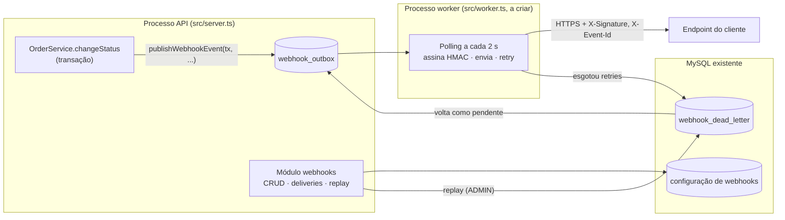

# RFC — Sistema de Webhooks de Notificação de Pedidos

| Campo | Valor |
|---|---|
| **Autora** | Larissa (Tech Lead) |
| **Status** | Em revisão |
| **Data** | 2026-10-15 (consolida a reunião técnica de quinta-feira, 09:00) |
| **Revisores** | Marcos (PM), Bruno (Eng. Pleno, Pedidos), Diego (Eng. Sênior, Plataforma), Sofia (Eng. de Segurança) |
| **Documentos relacionados** | [PRD](PRD.md) · [FDD](FDD.md) · [ADRs](adrs/README.md) · [Tracker](TRACKER.md) |

---

## 1. TL;DR

Propomos que o OMS **notifique clientes B2B por webhook (HTTP outbound)** sempre que o status de um pedido mudar, com latência abaixo de 10 segundos.

A mudança de status passa a gravar o evento numa **tabela outbox no MySQL, na mesma transação**. Um **worker em processo separado** lê essa tabela a cada 2 s e entrega o evento. A entrega é **assinada com HMAC-SHA256**, usando uma secret por endpoint. Falhas transitórias são retentadas **5 vezes com backoff exponencial** (até ~15 h). Esgotadas as tentativas, ou diante de uma falha definitiva (ex.: 4xx), o evento vai para uma **DLQ** que pode ser reprocessada manualmente por um ADMIN.

A garantia é **at-least-once**: o cliente deduplica pelo `X-Event-Id`. Não há infraestrutura nova, e o módulo segue os padrões já existentes no código. A estimativa é de **3 sprints**, incluindo a revisão de segurança.

## 2. Contexto e problema

Três clientes B2B (Atlas Comercial, MaxDistribuição e Nova Cargo) pediram formalmente para serem notificados quando o status dos pedidos deles muda. Hoje eles consultam `GET /orders` periodicamente, o que deixa a integração **lenta e cara**. A Atlas sinalizou que pode migrar para um concorrente se a funcionalidade não sair até o fim do trimestre ([09:00] Marcos). Para os clientes, "tempo real" é **menos de 10 segundos** ([09:02] Marcos). O fluxo é **apenas de saída**: os clientes recebem, não enviam ([09:02] Marcos).

O OMS não tem hoje nenhum mecanismo de eventos, filas ou notificação externa. A mudança de status acontece em `OrderService.changeStatus` (`src/modules/orders/order.service.ts`), dentro de uma transação que já atualiza o pedido, grava o histórico e mexe no estoque. Bruno a descreveu como "pesada" ([09:04] Bruno). Qualquer solução precisa respeitar duas restrições:

- **Atomicidade:** status alterado sem evento emitido é inaceitável, e o contrário também ([09:40] Bruno).
- **Isolamento:** um cliente lento ou fora do ar não pode travar a mudança de status de outros pedidos ([09:04] Bruno).

## 3. Proposta técnica

### 3.1 Visão geral

### 3.2 Componentes e responsabilidades

1. **Registro do evento (Outbox).** Dentro da transação de `changeStatus`, a função `publishWebhookEvent(tx, order, fromStatus, toStatus)` grava o evento na `webhook_outbox`. Se essa gravação falhar, a mudança de status é desfeita. → [ADR-001](adrs/ADR-001-outbox-no-mysql.md)
2. **O que é gravado.** Um **snapshot** do pedido no momento da mudança, enxuto e sem itens. Só se grava para os webhooks que **escolheram ouvir aquele status**: o filtro é aplicado na inserção. → [ADR-007](adrs/ADR-007-payload-snapshot-e-filtro-na-insercao.md)
3. **Entrega (Worker).** É um processo Node separado da API, com PrismaClient próprio e o mesmo banco. Ele faz polling a cada 2 s e processa os pendentes em ordem de criação, com **uma única instância**. → [ADR-002](adrs/ADR-002-worker-separado-em-polling.md)
4. **Falhas.** Timeout de 10 s. Falhas transitórias têm até 5 retentativas, após 1 min, 5 min, 30 min, 2 h e 12 h. Depois disso, ou de imediato em falhas definitivas como respostas 4xx, o evento vai para a DLQ em tabela própria, com replay manual restrito a ADMIN e auditado. → [ADR-003](adrs/ADR-003-retry-backoff-e-dlq.md)
5. **Autenticidade.** Assinatura HMAC-SHA256 do corpo, com uma secret por endpoint gerada pela plataforma. A secret pode ser rotacionada, e a anterior continua válida por 24 h. Só se aceitam URLs `https`. → [ADR-004](adrs/ADR-004-hmac-sha256-com-secret-por-endpoint.md)
6. **Semântica de entrega.** At-least-once. Cada evento leva um `X-Event-Id` (UUID) para o cliente deduplicar. → [ADR-005](adrs/ADR-005-entrega-at-least-once-com-x-event-id.md)
7. **Gestão pelo cliente.** O cliente cria, edita, remove e lista webhooks e consulta o histórico de entregas pela API existente, autenticado com JWT. Os contratos dos endpoints ficam no [FDD](FDD.md#6-contratos-públicos).
8. **Padrões.** O módulo `src/modules/webhooks` (a criar) replica a estrutura dos módulos atuais e reusa `AppError`, o middleware de erro, `requireRole`, Zod e Pino. Os códigos de erro usam o prefixo `WEBHOOK_`. → [ADR-006](adrs/ADR-006-reuso-dos-padroes-do-projeto.md)

### 3.3 Garantias e limitações, declaradas

| Propriedade | Garantia |
|---|---|
| Consistência status ↔ evento | Forte (mesma transação) |
| Entrega | At-least-once (podem ocorrer duplicatas) |
| Latência de descoberta | ≤ 2 s após o commit, sem contar o tempo de resposta do cliente |
| Ordem | Apenas **por pedido**, enquanto houver **um único worker** e **na primeira tentativa**: um evento em retry pode ser ultrapassado por eventos posteriores ([FDD §8](FDD.md#8-estratégias-de-resiliência)). Não há ordem global ([09:13] Larissa) |
| Janela de retentativa | ~15 h; depois disso, DLQ |

## 4. Alternativas consideradas

| # | Alternativa | Trade-off que motivou o descarte | Origem |
|---|---|---|---|
| ALT-1 | **Disparo HTTP síncrono** dentro de `changeStatus` | A transação é pesada: um cliente lento travaria mudanças de status de outros pedidos. Além disso, não faz sentido desfazer o status porque o cliente está fora do ar. | [09:04] Bruno, [09:06] Diego |
| ALT-2 | **Redis Streams / Redis Cluster** como fila | Daria mais vazão e reatividade, mas exigiria **subir e operar infraestrutura nova**: overengineering para um time pequeno. A outbox no MySQL existente atende. | [09:07] Larissa, [09:07] Diego |
| ALT-3 | **Trigger do banco** para acordar o worker | O MySQL não tem `LISTEN/NOTIFY`. O trigger só executa SQL e não notifica processo externo, então avisar o worker exigiria gambiarras. O polling de 2 s já atende o teto de 10 s. | [09:09] Bruno, [09:09] Diego |
| ALT-4 | **Worker dentro do processo da API** | Mais simples de implantar, mas um restart da API derruba o worker junto. | [09:11] Diego |
| ALT-5 | **Retry indefinido** ou **apenas 3 tentativas** | Retry indefinido deixa eventos pendurados para sempre. Com 3 tentativas, um cliente em manutenção planejada de 2 h perderia eventos. | [09:15] Diego, [09:16] Bruno, [09:16] Diego |
| ALT-6 | **Exactly-once** | Exigiria coordenação entre os dois lados e muito mais complexidade. At-least-once com `event_id` é o padrão de Stripe e GitHub. | [09:25] Diego |
| ALT-7 | **Secret global** da plataforma | Mais simples de gerenciar, mas "se vaza uma, vaza tudo". | [09:21] Sofia |

## 5. Questões em aberto

| # | Questão | Situação | Origem |
|---|---|---|---|
| Q1 | **Rate limiting de saída:** o que fazer quando um cliente tem dezenas de pedidos mudando de status no mesmo minuto? | Fora desta entrega. Observar em produção e decidir depois. | [09:38] Diego, [09:39] Larissa |
| Q2 | **Escalar além de um worker** sem perder a ordem por pedido | Adiado. Opções citadas: particionar por `order_id` ou lock pessimista. | [09:13] Diego |
| Q3 | **Avisar o cliente por email** quando o webhook dele falha repetidamente | Próxima fase, depois de medir o impacto. | [09:37] Marcos, [09:37] Larissa |
| Q4 | **Endurecer as permissões do CRUD de webhooks** (hoje vale qualquer usuário autenticado) | "Mais pra frente". Hoje o código não liga `User` a `Customer` (`prisma/schema.prisma`). | [09:37] Sofia |
| Q5 | **Arquivamento** das linhas já entregues (~30 dias) | Fora do escopo desta feature, sem dono definido. | [09:08] Diego |
| Q6 | **Listagem da DLQ:** o replay é por id ([09:18] Diego), mas não foi definido como o ADMIN descobre os ids | Nesta fase, consulta direta ao banco. Definir um endpoint de listagem na próxima fase. | [09:18] Diego, [09:35] Diego |
| Q7 | **Incluir o `X-Timestamp` na assinatura?** Com o HMAC só sobre o corpo, o header não impede replay de uma requisição capturada | Pendente da revisão de segurança. Recomendação: assinar `<X-Timestamp>.<corpo>` (ver [FDD §10](FDD.md#10-segurança)). Dona: Sofia. | [09:22] Sofia, [09:44] Diego, [09:46] Sofia |

### 5.1 Ambiguidades da reunião resolvidas nesta revisão

| # | Ponto ambíguo | Definição adotada | Origem |
|---|---|---|---|
| R1 | "5 tentativas" com 5 intervalos listados | **Envio inicial + 5 retentativas.** É a única leitura compatível com os ~15 h citados. → [ADR-003](adrs/ADR-003-retry-backoff-e-dlq.md) | [09:17] Diego, [09:48] Larissa |
| R2 | Granularidade da outbox | **Uma linha por par evento × webhook**, com `event_id`, retry e DLQ próprios. → [ADR-005](adrs/ADR-005-entrega-at-least-once-com-x-event-id.md) | [09:34] Bruno, [09:44] Sofia |
| R3 | Criação do pedido (`null → PENDING`) gera evento? | **Não nesta fase.** Só `changeStatus` publica. → [ADR-007](adrs/ADR-007-payload-snapshot-e-filtro-na-insercao.md) | [09:40] Bruno |

## 6. Impacto e riscos

**Impacto no sistema existente:** a única mudança no fluxo de pedidos é uma consulta e uma inserção a mais na transação de `changeStatus`. Fora isso, entram tabelas novas no MySQL e um processo novo (`npm run worker`). Os clientes passam a validar HMAC e deduplicar eventos, o que será documentado no portal ([09:26] Marcos). O detalhe está em [FDD §11 e §12](FDD.md#11-integração-com-o-sistema-existente).

**Riscos principais**

| Risco | Mitigação | Origem |
|---|---|---|
| Worker parado → entregas atrasam (single-worker é ponto único de falha) | Eventos persistem na outbox e nada se perde: o worker retoma de onde parou. Monitorar o tamanho da fila de pendentes (*proposta*, ver [Observabilidade no FDD](FDD.md#9-observabilidade)). | [09:11] Diego, [09:13] Larissa |
| Cliente não deduplica → processa eventos em dobro | Documentação em destaque no portal. `X-Event-Id` estável entre as tentativas. | [09:25] Sofia, [09:26] Marcos |
| Vazamento de secret de cliente (já aconteceu) | Secret por endpoint, rotação com 24 h de carência, revisão de segurança de 2 dias da Sofia. | [09:22] Diego, [09:21] Sofia, [09:46] Sofia |
| Inserção na outbox falha → mudança de status falha | Comportamento desejado: rollback garante que não exista status sem evento. | [09:40] Bruno, [09:41] Diego |
| Prazo: a Atlas quer a funcionalidade até o fim de novembro | Escopo enxuto, com email, dashboard e rate limiting fora. Estimativa abaixo. | [09:45] Marcos, [09:48] Larissa |

**Cronograma estimado** ([09:46] Larissa): modelagem de outbox e DLQ, 1 sprint · worker e retry, 1 sprint · CRUD e deliveries, ½ sprint · integração no `order.service` e testes ponta a ponta, ½ sprint · HMAC, schemas e validações, mais um pouco. **Total: 3 sprints**, com **2 dias úteis de revisão de segurança** reservados no fim ([09:46] Sofia, [09:47] Larissa).

## 7. Decisões relacionadas

| ADR | Decisão |
|---|---|
| [ADR-001](adrs/ADR-001-outbox-no-mysql.md) | Padrão Outbox no MySQL, na mesma transação do `changeStatus` |
| [ADR-002](adrs/ADR-002-worker-separado-em-polling.md) | Worker em processo separado, polling de 2 s, single-worker |
| [ADR-003](adrs/ADR-003-retry-backoff-e-dlq.md) | Retry com backoff 1m/5m/30m/2h/12h e DLQ com replay ADMIN |
| [ADR-004](adrs/ADR-004-hmac-sha256-com-secret-por-endpoint.md) | HMAC-SHA256, secret por endpoint, rotação com 24 h de carência |
| [ADR-005](adrs/ADR-005-entrega-at-least-once-com-x-event-id.md) | Entrega at-least-once com `X-Event-Id` |
| [ADR-006](adrs/ADR-006-reuso-dos-padroes-do-projeto.md) | Reuso dos padrões existentes do projeto |
| [ADR-007](adrs/ADR-007-payload-snapshot-e-filtro-na-insercao.md) | Payload como snapshot e filtro de status na inserção |

---

**Como revisar:** comente diretamente nas seções 3 a 5. As questões Q1 a Q6 podem seguir em aberto nesta entrega. A Q7 deve ser resolvida na revisão de segurança, antes do deploy. As definições R1 a R3 podem ser contestadas na revisão.
